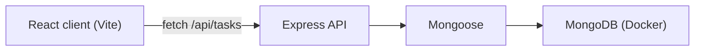

# Architecture — To-Do List App

## Overview

A single-user to-do app built on the MERN stack. A React client shows the current Monday–Sunday week, the selected day's tasks, and the week's completion summary. It talks to an Express API that stores tasks in MongoDB.

The requirements come from [USER_STORIES.md](USER_STORIES.md). For hands-on setup and deployment steps, see [WALKTHROUGH.md](WALKTHROUGH.md); this document covers what the system is and why.



## Stack

| Layer | Choice |
| --- | --- |
| Language | Plain JavaScript (ES modules), Node 22 |
| Client | React 18, Vite, Tailwind CSS 3, React Router 6 |
| API | Express 4, Mongoose 8, `cors`, `dotenv` |
| Database | MongoDB 7 in Docker (`docker-compose.yml`) |
| Tests | Vitest on both sides; Supertest and `mongodb-memory-server` on the API |
| Tooling | npm workspaces (`client`, `server`), `concurrently` |

The client deploys to Netlify ([`netlify.toml`](../netlify.toml)), with `VITE_API_URL` pointing at the deployed API. The API deploys to Render ([`render.yaml`](../render.yaml)) or Railway ([`server/railway.toml`](../server/railway.toml)); either just needs `MONGODB_URI` and `CLIENT_ORIGIN` set, since both platforms provide `PORT` themselves. Neither platform offers a managed MongoDB, so the database is MongoDB Atlas. See [WALKTHROUGH.md](WALKTHROUGH.md#9-deploying) for the full steps.

## Repository layout

```text
docker-compose.yml        MongoDB for local development
netlify.toml               Netlify build config for the client
render.yaml                Render Blueprint for the API
package.json              workspaces and top-level scripts
docs/
  USER_STORIES.md
  ARCHITECTURE.md
  WALKTHROUGH.md
  AUDIT_REPORT.md
server/
  .env.example
  railway.toml              Railway deployment config for the API
  src/
    index.js              connects to Mongo, starts the HTTP server
    app.js                Express app: JSON, CORS, routes, error handler
    db.js                 Mongoose connect and disconnect
    models/Task.js        Task schema
    routes/tasks.js       /api/tasks routes
    seed.js               sample tasks for the current week
  test/tasks.test.js
client/
  .env.example
  index.html
  public/_redirects        Netlify SPA fallback, copied into dist on build
  vite.config.js          /api proxy to the API in development
  tailwind.config.js
  postcss.config.js
  src/
    main.jsx  App.jsx  index.css
    api/tasks.js          fetch wrapper for the task API (list, search, create, update, delete)
    lib/week.js           Monday-week math and the summary
    lib/tasks.js          list helpers: sort, upsert, search match, group by day
    hooks/useToday.js     today's date as YYYY-MM-DD, changes only when the date rolls over
    hooks/useWeekTasks.js loads one week of tasks, refreshes on focus
    hooks/useTaskMutations.js  toggle, delete, and save against the API and a local list
    pages/                Welcome, Home, Search, and their acceptance tests
    components/           DayStrip, SummaryCards, WeeklyProgress, TaskList, WeekTaskList, TaskRow,
                          TaskSheet, SearchBar, ErrorBanner, icons
    test/                 Vitest setup, a fake task API, and an app render helper
```

## Task data model

Mongoose model `Task`:

| Field | Type | Rules |
| --- | --- | --- |
| `title` | string | required, trimmed, non-empty |
| `description` | string | optional, defaults to `""` |
| `date` | string `YYYY-MM-DD` | required |
| `startTime` | string `HH:mm` | required |
| `endTime` | string `HH:mm` | optional, `null` when unset |
| `priority` | `low` \| `medium` \| `high` | optional, `null` when unset |
| `completed` | boolean | defaults to `false` |
| `createdAt`, `updatedAt` | Date | Mongoose timestamps |

The `date` field is indexed. It is stored as a calendar-day string rather than a `Date`, so a task cannot move to a different day when the client and server are in different time zones. Lexicographic order on `YYYY-MM-DD` is also chronological order, which keeps range queries simple.

## REST API

Base path: `/api`.

| Method | Path | Purpose |
| --- | --- | --- |
| `GET` | `/health` | liveness check, returns `{ ok: true }` |
| `GET` | `/tasks?from=YYYY-MM-DD&to=YYYY-MM-DD` | tasks whose `date` is in the inclusive range |
| `GET` | `/tasks?q=keyword` | case-insensitive match on title or description (US-15) |
| `POST` | `/tasks` | create a task |
| `PATCH` | `/tasks/:id` | update any subset of fields |
| `DELETE` | `/tasks/:id` | delete a task, returns 204 |

List responses are arrays sorted by `date`, then `startTime`. Each task is serialized with `id` instead of `_id`.

Errors are JSON:

- `400 { error, fields }` for validation failures. `fields` maps field name to message.
- `400 { error }` for a malformed id or bad query parameters.
- `404 { error }` for an unknown id.
- `500 { error }` for anything else.

## Week rules

All week math lives in `client/src/lib/week.js`:

- `toISODate(date)` formats a local date as `YYYY-MM-DD`. `fromISODate(iso)` parses one back to a local date.
- `startOfWeek(date)` returns the Monday of the week that contains `date`. Sunday belongs to the week that started six days earlier.
- `weekDays(date)` returns the seven days Monday–Sunday as `{ iso, weekday, dayOfMonth }`.
- `weekRange(date)` returns `{ from, to }` (Monday and Sunday) for the API range query.
- `isSameDay(a, b)` compares calendar days.
- `summarize(tasks)` returns `{ completed, pending, total, percent }`. `percent` is 0 when `total` is 0.

The client loads one week of tasks with a single range request. It derives the selected day's list and the summary from that array, so any change to the array recalculates the Task Complete card, the Task Pending card, and Weekly Progress together.

Keeping the week current:

- `useToday` re-reads the clock at midnight and whenever the window regains focus or becomes visible. Its value is the date string, so it only changes when the calendar date rolls over. Home resets the selected day to the new today only on that change; an ordinary focus on the same date leaves the user's selection alone. If a new week has started, Home loads that week.
- `useWeekTasks` quietly reloads the week when the window regains focus, so changes made elsewhere (another tab, the API) appear without a full reload. A failed quiet reload keeps the last good data on screen.
- Until the week has loaded, the cards show `--` and the progress bar has no value, so a loading or failed request is never shown as zero tasks.

## Client structure

- Routes: `/` is Welcome. `/home` is Home. `/search?q=` is Search. Unknown paths redirect to `/`.
- **Get Started** navigates to `/home` with `replace`, so going back does not reopen the welcome screen.
- Home keeps its view state in the URL: `?day=YYYY-MM-DD` for a selected day other than today, and `?view=week` for **View All**. Leaving for Search and pressing Back therefore restores the same day and view. A `day` outside the current week is ignored.
- The home search field opens `/search?q=` on Enter or the search icon. Search filters as you type (debounced 250 ms), keeps `q` in the URL, and its Back control returns to the previous screen, or to `/home` when Search was opened directly.
- `TaskSheet` is a modal bottom sheet used for both **Add New Task** and **Edit Task**. It validates title, date, and start time before sending and also shows field errors returned by the API. Close, Escape, or a tap on the backdrop dismisses it without saving, and each open starts from fresh values.
- Row actions are optimistic for the checkbox: the row and the weekly counts change at once, and are put back with an error banner if the API call fails. Delete and save update the list after the API confirms. After a save, a task that no longer belongs to the list on screen (moved out of the week, or no longer matching the search) leaves it.
- `api/` wraps `fetch`. `hooks/` own data loading. `pages/` compose screens. `components/` are presentational. `lib/` is pure logic with no React.
- Layout is a centered mobile column (`max-w-md`), matching the reference screens.
- Design tokens in `tailwind.config.js`:
  - `brand` blue `#3F5BF6` (strong variant `#2A3FB8`)
  - `complete` light blue card
  - `pending` light red card
  - `ink` text colors

## Environment

| Variable | Where | Default |
| --- | --- | --- |
| `MONGODB_URI` | server | `mongodb://localhost:27017/todo` |
| `PORT` | server | `5000` locally. Render and Railway inject this themselves in production; the app already reads `process.env.PORT`. |
| `CLIENT_ORIGIN` | server | `http://localhost:5173` (CORS allow-list, comma-separated) |
| `VITE_API_URL` | client | empty, so requests use relative `/api` and the Vite proxy in development. In production, the API's origin only, no `/api` suffix. |
| `API_PROXY_TARGET` | client dev server | `http://localhost:5000` (where Vite forwards `/api`). Read with `loadEnv` in `vite.config.js`, so it can come from `client/.env` as well as the real shell environment. |
| `MONGODB_TEST_URI` | server, test only | unset, so `server/test/tasks.test.js` uses an in-memory MongoDB. Set it to run those tests against Docker Mongo instead. |

Each package has a `.env.example`.

## Scripts

From the repository root:

| Command | Effect |
| --- | --- |
| `npm run db:up` / `npm run db:down` | start or stop MongoDB in Docker |
| `npm run seed` | replace all tasks with sample tasks for the current week |
| `npm run dev` | run the API (port 5000) and the client (port 5173) together |
| `npm test` | run the server and client test suites |
| `npm run build` | build the client into `client/dist` |

## Testing

- **Client:** Vitest unit tests for `lib/week.js`, covering the Monday start, month boundaries, and summary math. Unit tests for `lib/tasks.js`. Acceptance tests in `pages/*.test.jsx` render the whole app through `src/test/renderApp.jsx`, using jsdom and Testing Library with an in-memory fake of the task API (`src/test/fakeApi.js`, which supports list, search, create, update, and delete) and a fixed system date. Each `describe` block is named after the user story it covers.
- **Server:** Vitest with Supertest against the Express app and an in-memory MongoDB (`mongodb-memory-server`), so tests do not need Docker. The first run downloads a MongoDB binary of about 600 MB. To skip that and run against the Docker container instead, set `MONGODB_TEST_URI` (for example `mongodb://localhost:27017/todo_test`). The suite empties the task collection in that database before each test.

## Story map

| Story | Modules | Status |
| --- | --- | --- |
| US-01 Welcome screen | `pages/Welcome.jsx` | built |
| US-02 Enter home | `App.jsx`, `pages/Welcome.jsx` | built |
| US-03 Current week | `lib/week.js`, `components/DayStrip.jsx` | built |
| US-04 Selected day's tasks | `hooks/useWeekTasks.js`, `components/TaskList.jsx`, `components/TaskRow.jsx` | built |
| US-05 Weekly summary | `lib/week.js`, `components/SummaryCards.jsx`, `components/WeeklyProgress.jsx` | built |
| US-06 View All | `pages/Home.jsx`, `components/WeekTaskList.jsx` | built |
| US-07 Empty states | `components/TaskList.jsx`, `components/WeekTaskList.jsx` | built |
| US-08 Toggle status | `components/TaskRow.jsx`, `hooks/useTaskMutations.js`, `PATCH /tasks/:id` | built |
| US-09 – US-12 Create | `components/TaskSheet.jsx`, `POST /tasks` | built |
| US-13 Edit | `components/TaskSheet.jsx`, `PATCH /tasks/:id` | built |
| US-14 Delete | `components/TaskRow.jsx`, `hooks/useTaskMutations.js`, `DELETE /tasks/:id` | built |
| US-15 – US-17 Search | `pages/Search.jsx`, `GET /tasks?q=` | built |
| US-18 Persistence | MongoDB through the API | built |
