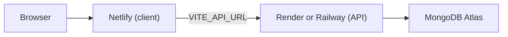

# Walkthrough — From Clone to Deployed

This is the one guide to follow start to finish: get the app running locally, understand the environment variables, and deploy it. For what the app does, see [USER_STORIES.md](USER_STORIES.md). For how it is built, see [ARCHITECTURE.md](ARCHITECTURE.md).

## 1. Prerequisites

- **Node.js 20 or later** (developed on Node 22). Check with `node -v`.
- **npm 10 or later** (comes with Node). Check with `npm -v`.
- **Docker Desktop**, running, for the local MongoDB container.
- A terminal and this repository, already on disk.

## 2. Install dependencies

From the repository root, not from `client/` or `server/`:

```bash
npm install
```

This is an npm workspaces project (`client` and `server` are both workspaces of the root `package.json`), so one install at the root installs both.

## 3. Configure environment variables

Nothing is committed with real values; copy each template and adjust it.

```bash
cp server/.env.example server/.env
cp client/.env.example client/.env
```

| File | Variable | What it does |
| --- | --- | --- |
| `server/.env` | `MONGODB_URI` | Where the API connects. The default matches the Docker container started in the next step. |
| `server/.env` | `PORT` | What port the API listens on locally. Defaults to `5000`. |
| `server/.env` | `CLIENT_ORIGIN` | Which origin(s) the API accepts requests from (CORS). Defaults to `http://localhost:5173`. |
| `server/.env` | `MONGODB_TEST_URI` | Optional. Points the server test suite at Docker Mongo instead of downloading an in-memory one. See [§6](#6-run-the-tests). |
| `client/.env` | `VITE_API_URL` | Leave empty in development. In production, the deployed API's origin, no trailing `/api`. |
| `client/.env` | `API_PROXY_TARGET` | Dev-server only. Where the Vite `/api` proxy forwards to. Only needed if your local API isn't on port 5000. |

Both `client/.env` and `server/.env` are git-ignored; only the `.env.example` files are committed. If a variable you need isn't in the table above, check `docs/ARCHITECTURE.md` under **Environment**, which is kept in sync with what the code actually reads.

## 4. Start MongoDB

```bash
npm run db:up
```

This runs `docker compose up -d mongo` (see [`docker-compose.yml`](../docker-compose.yml)), starting MongoDB 7 on `localhost:27017` with its data in a named Docker volume, so it survives container restarts. Stop it later with `npm run db:down`.

If this fails, Docker Desktop is probably not running yet.

## 5. Seed sample data (optional but recommended)

```bash
npm run seed
```

This replaces all tasks with a handful of sample tasks spread across the current week, some completed, so the home screen has something to show. See `server/src/seed.js`.

## 6. Run the tests

```bash
npm test
```

This runs the server suite, then the client suite.

- The **server** suite (`server/test/tasks.test.js`) uses an in-memory MongoDB via `mongodb-memory-server`. On its very first run on a machine, it downloads a ~600 MB MongoDB binary, which can be slow and can time out on a slow connection. To skip that and run against the Docker container from step 4 instead:

  ```bash
  # macOS/Linux
  MONGODB_TEST_URI=mongodb://localhost:27017/todo_test npm test -w server

  # Windows PowerShell
  $env:MONGODB_TEST_URI = 'mongodb://localhost:27017/todo_test'; npm test -w server
  ```

  Or set `MONGODB_TEST_URI` once in `server/.env` so every run uses it.

- The **client** suite (`client/src/**/*.test.jsx`) uses jsdom and an in-memory fake of the task API, so it needs no services running at all.

Both suites are also listed in `docs/ARCHITECTURE.md` under **Testing**.

## 7. Run the app

```bash
npm run dev
```

This runs the API and the client together (via `concurrently`):

- API: `http://localhost:5000`
- Client: `http://localhost:5173`, proxying `/api/*` to the API

Open `http://localhost:5173` and you should land on the welcome screen.

### If a port is already busy

Something else on the machine may already be listening on 5000 or 5173. Pick different ports instead of fighting over them:

```bash
# macOS/Linux
PORT=5050 npm run dev -w server
API_PROXY_TARGET=http://localhost:5050 npm run dev -w client   # in a second terminal

# Windows PowerShell
$env:PORT = '5050'; npm run dev -w server
$env:API_PROXY_TARGET = 'http://localhost:5050'; npm run dev -w client   # in a second terminal
```

`API_PROXY_TARGET` can also simply be set in `client/.env` (see the table in §3) instead of exporting it each time.

## 8. Build for production

```bash
npm run build
```

Builds the client only (the API needs no build step) into `client/dist`. Preview the production build locally with:

```bash
npm run preview -w client
```

## 9. Deploying

The app deploys as two pieces: the client (static files) to **Netlify**, and the API to **Render** or **Railway**. Neither Render nor Railway offers a first-party managed MongoDB, so the database is **MongoDB Atlas** regardless of which one you pick for the API.



### 9.1 Database: MongoDB Atlas

1. Create a free cluster at [mongodb.com/atlas](https://www.mongodb.com/atlas).
2. Under Network Access, allow access from anywhere (`0.0.0.0/0`), since Render and Railway don't publish fixed outbound IPs on their free tiers.
3. Create a database user and copy the connection string. This becomes `MONGODB_URI` in step 9.2 or 9.3.

### 9.2 API on Render

[`render.yaml`](../render.yaml) at the repository root is a Render Blueprint.

1. In the Render dashboard: **New** → **Blueprint**, point it at this repository.
2. Render reads `render.yaml` and proposes one web service (`todo-api`), built from the `server/` directory.
3. It prompts for `MONGODB_URI` and `CLIENT_ORIGIN` (both marked `sync: false` in the blueprint, meaning Render asks you for the value rather than guessing one). Paste in the Atlas connection string for `MONGODB_URI`. `CLIENT_ORIGIN` can be filled in after step 9.4, once you know the Netlify URL.
4. Render sets `PORT` itself; the API already reads `process.env.PORT`, so nothing to do there.
5. Deploy. The health check path is `/api/health`.

### 9.3 API on Railway (alternative to Render)

[`server/railway.toml`](../server/railway.toml) configures the service once Railway is pointed at the `server/` directory.

1. In the Railway dashboard: **New Project** → **Deploy from GitHub repo**, pick this repository.
2. In the new service's **Settings → Root Directory**, set it to `server`, so Railway finds `railway.toml` and only builds that workspace.
3. In **Variables**, set `MONGODB_URI` (the Atlas connection string, or a MongoDB added from Railway's template marketplace) and `CLIENT_ORIGIN`.
4. Railway sets `PORT` itself, same as Render.
5. Deploy. The health check path is `/api/health`.

You only need one of Render or Railway, not both.

### 9.4 Client on Netlify

[`netlify.toml`](../netlify.toml) and [`client/public/_redirects`](../client/public/_redirects) configure the build.

1. In the Netlify dashboard: **Add new site** → **Import an existing project**, pick this repository. Netlify reads `netlify.toml` automatically: it runs `npm install && npm run build` from the repository root and publishes `client/dist`.
2. Before the first deploy, set an environment variable: **Site configuration → Environment variables** → `VITE_API_URL` = the API's origin from step 9.2 or 9.3, for example `https://todo-api.onrender.com`. No trailing slash, and no `/api` suffix — the client already appends `/api/...` itself.
3. Deploy. `client/public/_redirects` is copied into `client/dist` on build, and sends every path to `index.html` with a 200, so refreshing `/home` or `/search` doesn't 404.

### 9.5 Finish connecting the two

Once Netlify gives you its URL (for example `https://todo-app.netlify.app`), go back to the API's environment variables (Render or Railway) and set `CLIENT_ORIGIN` to that exact URL, then redeploy or restart the API. `CLIENT_ORIGIN` accepts a comma-separated list if you need more than one origin.

**Netlify deploy previews get a different, unpredictable URL each time** (`deploy-preview-123--your-site.netlify.app`), which `CLIENT_ORIGIN`'s exact-match comparison won't allow. Test against the production Netlify URL, or widen the server's CORS check if you need previews to reach the API too.

### 9.6 Verify

Open the deployed Netlify URL, confirm the welcome screen appears, press **Get Started**, and check that tasks load. If they don't, open the browser's developer tools and check the Network tab for the `/api/tasks` request:

- A CORS error almost always means `CLIENT_ORIGIN` on the API doesn't exactly match the Netlify URL yet.
- A failed connection usually means `VITE_API_URL` is wrong, or has a stray `/api` or trailing slash in it.

## 10. Where things live

| What | File |
| --- | --- |
| Local MongoDB | [`docker-compose.yml`](../docker-compose.yml) |
| Netlify build and redirects | [`netlify.toml`](../netlify.toml), [`client/public/_redirects`](../client/public/_redirects) |
| Render deployment | [`render.yaml`](../render.yaml) |
| Railway deployment | [`server/railway.toml`](../server/railway.toml) |
| Environment variable templates | [`server/.env.example`](../server/.env.example), [`client/.env.example`](../client/.env.example) |
| Full architecture and env variable reference | [`ARCHITECTURE.md`](ARCHITECTURE.md) |
